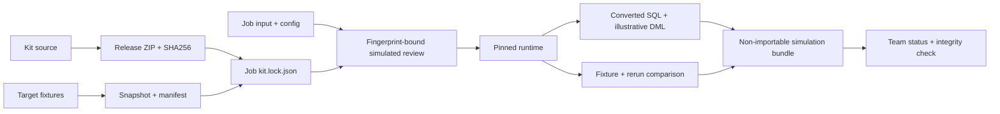

# Architecture decisions

## ADR-001 — Central source, pinned executable release

`kit/src/migrate_kit` เป็น source กลางหนึ่งชุด ใช้ standard library เท่านั้น
`freeze-kit` รวมโค้ดและ resources เป็น deterministic ZIP และ manifest ระบุ SHA-256
`new-job` บันทึก version/hash ลง kit.lock.json และอ่านแม่แบบจาก release ZIP
`simulate` ตรวจ hash แล้ว import runtime จาก ZIP ผ่าน subprocess ที่ cwd เป็น job

ดังนั้นแก้ source สำหรับรุ่นถัดไปได้โดยไม่เปลี่ยน runtime ของงานเดิม
release archive เป็นของ build; manifest เป็นประวัติที่ตรวจสอบได้
ต้นแบบเก็บ archive ใน cache ท้องถิ่น; ระบบจริงต้องมีที่เก็บ immutable release แยก

## ADR-002 — Shared reference by immutable snapshot

ใช้ hash ของรายการไฟล์สร้าง snapshot ID และตรวจไฟล์ทุกครั้งก่อนรัน
current.json ใช้เลือกค่าเริ่มต้นสำหรับงานใหม่เท่านั้น งานเก่าอ้าง snapshot ที่ล็อกไว้
ไม่ copy schema/fixtures ทั้งชุดลงแต่ละงาน

## ADR-003 — Evidence belongs to the job

input/config/kit.lock เป็น governed inputs และสร้าง fingerprint
simulated approval อ้าง fingerprint นี้ ผล simulation อ้าง fingerprint และ hash ของ output
เมื่อ governed inputs เปลี่ยน รายงานสถานะแสดง STALE; เมื่อ output ถูกแก้ check จะล้ม
runtime สร้าง manifest รายการไฟล์ที่ใช้ใน package ชัดเจน ไม่ glob เอา output เก่าปน

## ADR-004 — Honest simulation boundary

Runtime มี restricted converter ไม่ใช่ full SQL parser
ใช้ SQLite อ่าน fixture และ Python จำลอง load strategy เทียบ curated expected rows
ไม่มี Oracle/Spark/ODI driver, network call หรือ GitHub client
XML root คือ MigrationSimulationPlan และมี importableInODI=false
G4–G7 คง NOT_EXECUTED แม้ simulation และการซ้อม lock ผ่าน

## ADR-005 — Local import-lock rehearsal

exclusive file creation เลือกผู้ชนะหนึ่งรายเมื่อสอง process ใช้ directory เดียว
ผู้ปลดต้องเป็น job และ holder เดิม ประวัติถูกบันทึกว่า actual_odi_import=false
ไม่อ้างว่าแก้ปัญหาการจองข้าม clone/เครื่องแล้ว ระบบทีมจริงต้องมี authoritative lock service
หรือ deployment coordinator กลางที่จองแบบ atomic และตรวจสิทธิ์ได้

## ADR-006 — Oracle adapter outside the pinned kit

ส่วนต่อ Oracle port จาก `runpack/dbx.py` ของ Migrate_ODI_Team2 (kit 2.15.0) มาไว้ที่ `tools/dbcore`
แทนการใส่ใน `kit/src` เพื่อไม่เปลี่ยน hash ของ kit 0.1.0 และไม่ให้ runtime ของ `simulate` มี dependency หรือ network
เรียกผ่าน `tools/workspace.py` (db-status / db-policy / db-connect / db-driver / db-test / run-sql)

- กติกาทีมอยู่ที่ `shared/team.json` → `db` (ai_access / select_mode / users / read_odi_log / default_env); ค่าเริ่มต้นคือคนรันเอง
- ค่าการเชื่อมต่ออยู่ที่ `shared/db.local.json` ต่อเครื่อง ไม่มีรหัสผ่าน ไม่ขึ้น Git; รหัสผ่านมาจาก env var หรือ getpass
- ทุกการรันผ่านแผนที่ผูก SHA-256 ของไฟล์ + ผู้อนุญาต; คำสั่งที่ลบแล้วกู้คืนไม่ได้ต้องยืนยันชื่อตาราง; split user ใช้ session READ ONLY
- ผลเก็บที่ `<job>/db_runs/` นอก `input/` เพื่อไม่ให้ fingerprint ของ simulated review เปลี่ยน; log ที่ `status/DB_RUN_LOG.md`
- การรันฐานจริงไม่เปลี่ยน G4–G7 และไม่ใช่การอนุมัติ deploy; การนำ adapter เข้า kit ต้องออก kit รุ่นใหม่พร้อมทดสอบ

## ADR-007 — Immutable release store, verify source per file

ปัญหา: ZIP ที่ `freeze-kit` สร้างขึ้นกับ zlib ของเครื่อง (Windows Python 3.13 กับ Linux/zlib-ng ให้ byte ต่างกัน)
บนเครื่องอื่น/CI จึงได้ SHA-256 ไม่ตรง manifest และ freeze ถูกปฏิเสธ งานที่ล็อก 0.1.0 ไม่มี runtime ให้รัน

การตัดสินใจ (ไม่แก้ `kit/src` จึงไม่ต้องออกรุ่นใหม่):
- เก็บ archive ตัวจริงที่ `kit/releases/<version>.zip` คู่ manifest ขึ้น Git ห้ามเขียนทับ; `.cache/kit/` เป็นสำเนาที่ลบได้
- `tools/kitstore.py` ทำงานก่อนคำสั่งของ kit: คืน cache จาก store เมื่อหาย (ตรวจ SHA-256 ก่อน)
- `freeze-kit` ของรุ่นที่มีอยู่: เทียบ source/resources กับ `files` ใน manifest ทีละไฟล์ ถ้าตรงใช้ archive เดิม
  ถ้าไม่ตรงให้ kit freeze ตามเดิมซึ่งจะปฏิเสธ "Bump kit version"; รุ่นใหม่ freeze แล้ว publish เข้า store ครั้งเดียว
- ตั้งแต่ kit 0.2.0 ให้เปลี่ยน `archive_bytes` เป็น `ZIP_STORED` ด้วย เพื่อให้สร้างซ้ำได้ byte-for-byte โดยไม่พึ่ง store

ผล: clone ใหม่, Linux และ GitHub Actions ใช้ release เดิมได้; ขนาด archive ~18 KB ต่อรุ่น
ระยะยาว (D-02) อาจย้าย archive ไป GitHub Release / artifact storage โดยคงการตรวจ SHA-256 เดิม

## ADR-008 — Knowledge and AI context are part of the pinned kit (0.2.0)

`kit/knowledge/**` และ `kit/ai/claude/**` เข้า release ZIP เหมือน runtime · `new-job` ติดตั้งลง `knowledge/` และ `.claude/` ของงาน
(แทน `{{PROJECT}}/{{JOB}}/{{KIT}}`) และบันทึก hash ของไฟล์ที่ล็อกใน `kit.lock.json` → `ai_context`
- ล็อก: `.claude/**`, `knowledge/reference/**` · แก้ได้ในงาน: `CLAUDE.md`, `knowledge/WORKFLOW.md`, `lessons-learned.md`, `glossary-kit.md`
- `check` FAIL เมื่อไฟล์ที่ล็อกถูกแก้ — กฎกลางเปลี่ยนได้ทางเดียวคือออก kit รุ่นใหม่ งานเดิมคงรุ่นเดิม (แก้ปัญหา patch ค้างในงานแบบ R-01)
- ต้นฉบับมาจากงาน SS_ESIM (2.15.0 + patch) ผ่าน baseline W-12; ที่มาและการปรับรายไฟล์อยู่ใน `kit/ai/claude/SOURCE.json`
- คำสั่ง/agent ที่อ้างเครื่องมือที่ยังไม่มีได้ป้าย ⚠️ ห้าม AI สร้าง scripts เอง · `settings.json` (hooks) ยังไม่นำมา
- release ZIP ใหญ่ขึ้น (~0.8 MB STORED) เพราะ knowledge ~0.5 MB

## ADR-009 — Delivery mode: pinned kit scripts installed into the job (0.3.0)

ทางเลือก: (ก) แปลง scripts ทั้งชุดให้รันจาก ZIP / ไม่มี `__file__` → แก้หลายสิบจุด เสี่ยงผลต่างจากงานจริง
(ข) ติดตั้ง scripts ของ release ลง `scripts/` ของงานแบบล็อก hash (เหมือน ADR-008) → รันแบบเดียวกับ Migrate_ODI_Team2 ทุกอย่าง
เลือก (ข): ความถูกต้องพิสูจน์ได้ด้วย replay ของ SS_ESIM ทุกไฟล์ และป้องกัน patch ค้างในงาน (R-01) ด้วย `check` + settings deny
- runtime ต้นทาง = scripts ของงาน SS_ESIM (2.15.0 + patch) · ที่มารายไฟล์และ patch ของชุดนี้อยู่ `kit/delivery/SOURCE.json`
- patch เฉพาะที่จำเป็น: R-08 (convert ไม่ทับ SQL ที่ review) และ SQL ผ่าน `workspace.py run-sql` เท่านั้น
- งาน delivery ไม่มี synthetic target / simulated review — Gate จริงอยู่ที่ `status/GATES.md` · Smart Import ยังเป็นคนทำ
- `production_import_allowed=false` คงไว้: เครื่องมือไม่ import ODI เอง · G4+ ต้องมีหลักฐานจากคนตามกติกาเดิมของ GATES

## ADR-010 — Team knowledge layer and approved kit-promote (0.4.0)

ปัญหา: บทเรียนที่ใช้ได้ทุกงานติดอยู่ในงานเดียว · ส่งเข้า kit ได้ทางเดียวคือแก้ `kit/knowledge` + ออก release (ช้า และไม่มีคนอนุมัติที่ตรวจย้อนได้)
ทางเลือก: (ก) promote เข้า `kit/knowledge` ตรง ๆ → ทุกบทเรียนต้องออกรุ่น kit · งานที่ล็อกรุ่นเก่าไม่เห็น
(ข) ชั้น "ทีม" `shared/knowledge` แบบ append-only + ledger → ทุกงานเห็นทันที · ความรู้ไม่เปลี่ยนพฤติกรรมของ runtime ที่ล็อก จึงไม่ต้องผูกรุ่น
เลือก (ข):
- engine เดียว `kit/delivery/scripts/ws/wiki.py` — งาน delivery รันเป็น `scripts/ws/wiki.py` · root ใช้ `tools/wikicmd.py` (`wiki-search / wiki-step / wiki-check / kit-promote`) ได้ทุกงานทุกรุ่น
- `kit-promote` = แผน (plan id ผูกเนื้อหา) → คนอนุมัติ (ชื่ออยู่ `shared/approvers.json` → `knowledge_approvers`) → apply · ยกเฉพาะบทเรียนหัวข้อ 2 ที่มีหลักฐาน หมวด และ "generic"
- ห้ามลบประวัติแม้ไม่มี git: `PROMOTIONS.json` เก็บ id + SHA ของแถว · `check` FAIL เมื่อ LT# หาย · WARN เมื่อแก้โดยไม่มี `แก้ YYYY-MM-DD`
- การแก้สคริปต์ (K#) ไม่ผ่าน kit-promote — ผู้ดูแล kit แก้ `kit/` + ออกรุ่นใหม่ + replay regression (ADR-009)
- บทเรียนทีมที่มั่นคงแล้ว ผู้ดูแล kit ยกเข้า `kit/knowledge` ได้ตอนออกรุ่น (คงเลข LT#)

